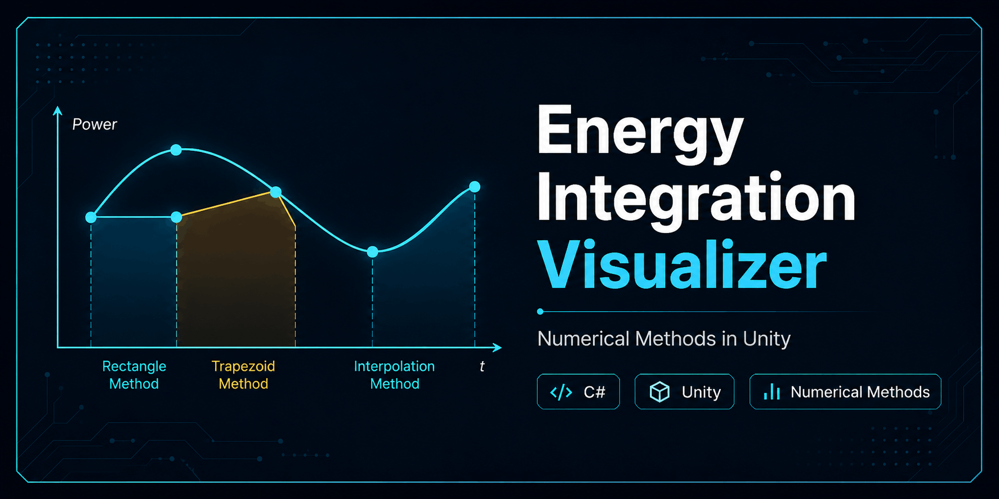

<p align="center">
  
</p>

<br>
# Object-Oriented Modelling and Programming in Engineering

**Author:** Saggu Nagaraju

This repository contains a Unity/C# implementation of a numerical integration task for an oscillating energy system. The project calculates the energy consumption of a given power function, visualizes the original function, compares numerical integration results with a reference analytical value, and demonstrates the software structure using object-oriented C# scripts.

The project was developed as a complete engineering programming workflow: mathematical formulation, analytical result preparation, numerical algorithm implementation, plotting, error calculation, testing, and documentation.

---

## Table of Contents

- [Project Overview](#project-overview)
- [Problem Statement](#problem-statement)
- [Mathematical Model](#mathematical-model)
- [Project Goals](#project-goals)
- [Implemented Numerical Methods](#implemented-numerical-methods)
- [Tools and Technologies](#tools-and-technologies)
- [Repository Structure](#repository-structure)
- [Code Structure](#code-structure)
- [How to Run the Project](#how-to-run-the-project)
- [Results](#results)
- [My Contribution](#my-contribution)
- [Skills Demonstrated](#skills-demonstrated)
- [Possible Improvements](#possible-improvements)

---

## Project Overview

The project focuses on calculating the energy consumption of an oscillating power system over a fixed time interval. The power signal is represented as a combination of a linearly increasing term and a sinusoidal oscillation.

The implementation uses C# scripts in Unity to:

- compute grid points of the power function,
- plot the function over time,
- approximate the integral numerically,
- visualize the integration area,
- calculate absolute and relative error,
- compare the numerical result with a reference analytical value,
- organize the solution into separate object-oriented classes.

This makes the project useful as a small engineering simulation and programming example for numerical methods, function plotting, and object-oriented software design.

---

## Problem Statement

For an oscillating energy system, the given power function must be evaluated over a time range of **20 seconds**. The required task is to calculate the total energy consumption by integrating the power function.

The task requires:

- plotting the power function,
- calculating the analytical integral,
- calculating the numerical integral using three different approaches,
- visualizing the approximated integration area,
- calculating absolute and relative error,
- preparing C# classes for implementation and testing,
- preparing diagrams and result documentation.

---

## Mathematical Model

The power function is defined as:

```text
P(t) = a1 * t + sin(2 * pi * f1 * t)
```

where:

```text
a1 = registration number / 40000
f1 = 2 Hz
```

In this implementation:

```text
a1 = 3.16985
f1 = 2 Hz
```

Therefore, the implemented function is:

```text
P(t) = 3.16985 * t + sin(4 * pi * t)
```

The reference analytical energy value used for comparison is:

```text
E(20) = 634.469
```

The numerical methods approximate:

```text
E(t) = integral of P(t) from 0 to t
```

---

## Project Goals

The main goals of this project are:

1. **Model the power function** of an oscillating energy system.
2. **Calculate energy consumption** over a fixed time interval.
3. **Implement three numerical integration strategies** in C#.
4. **Visualize the function and integration area** inside Unity.
5. **Compare numerical and analytical results** using error metrics.
6. **Apply object-oriented programming principles** through separated classes and methods.
7. **Document the design** using algorithm diagrams and UML-style structure.

---

## Implemented Numerical Methods

The project includes three numerical integration approaches.

### Method 1: Left Grid-Point Approximation

This method takes the value of the current grid point as the height of the rectangle between two consecutive grid points.

Concept:

```text
Area between x0 and x1 = y0 * delta_x
```

Implementation file:

```text
METHOD1.cs
```

---

### Method 2: Mean Value Approximation

This method uses the mean value between two consecutive function values to approximate the area between them.

Concept:

```text
Area between x0 and x1 = ((y0 + y1) / 2) * delta_x
```

Implementation file:

```text
METHOD2.cs
```

---

### Method 3: Linear Interpolation Approximation

This method visualizes the area using linear interpolation between two consecutive grid points.

Concept:

```text
Interpolated value = y0 + (y1 - y0) * interpolation_factor
```

Implementation file:

```text
METHOD3.cs
```

---

## Tools and Technologies

| Category | Tool / Language |
|---|---|
| Programming language | C# |
| Development environment | Unity |
| Plotting support | FunctionPlotter / OOMPE library |
| Mathematical expression parser | mXparser |
| Main programming concept | Object-oriented programming |
| Numerical method topic | Numerical integration |
| Visualization | Unity scene and plotted function lines |
| Testing script | `TestIntegration.cs` |

---

## Repository Structure

Recommended repository structure:

```text
.
├── Assets/
│   └── Scripts/
│       ├── METHOD1.cs
│       ├── METHOD2.cs
│       ├── METHOD3.cs
│       ├── PlotterDemo.cs
│       └── TestIntegration.cs
│
├── docs/
│   ├── Object-Oriented-Modelling-and-Programming.pdf
│   └── Tasks.pdf
│
└── README.md
```

Uploaded project files:

| File | Purpose |
|---|---|
| `METHOD1.cs` | Implements the first numerical integration method using grid-point rectangle approximation |
| `METHOD2.cs` | Implements the second numerical integration method using mean-value based approximation and plotting |
| `METHOD3.cs` | Implements the third method using interpolation-based visualization |
| `PlotterDemo.cs` | Demonstrates plotting of the original function using the FunctionPlotter utility |
| `TestIntegration.cs` | Provides a testing entry point for running selected methods |
| `Object-Oriented Modelling and Programming.pdf` | Final report containing formulas, diagrams, plots, and results |
| `Tasks.pdf` | Original task description and required deliverables |

---

## Code Structure

### `METHOD1.cs`

Main responsibilities:

- defines the registration number and coefficient `a`,
- calculates function values from `t = 0` to `t = 20`,
- uses a step size of `0.1`,
- adds rectangular visualization lines to the plot,
- calculates total numerical energy,
- calculates absolute and relative error,
- plots the final result in Unity.

Important logic:

```csharp
pt = (a * i) + Math.Sin(2 * Math.PI * frequency * i);
totalEnergy += 0.1 * pt;
```

---

### `METHOD2.cs`

Main responsibilities:

- initializes the same power function,
- calculates current and next grid-point values,
- computes the mean value between two consecutive points,
- plots the mean-value approximation,
- calculates total energy and error values,
- displays the result using the plotter.

Important logic:

```csharp
double meanValue = (energyPoint + nextEnergyPoint) / 2.0;
```

---

### `METHOD3.cs`

Main responsibilities:

- initializes the function and plotting object,
- calculates point values over the selected time range,
- performs interpolation between consecutive points,
- visualizes interpolated integration lines,
- calculates total energy and error values,
- plots the final graph.

Important logic:

```csharp
return a + (b - a) * t;
```

---

### `PlotterDemo.cs`

Main responsibilities:

- creates the function string,
- initializes `FunctionPlotter`,
- configures line width, background color, function color, additional line color, sphere color, resolution, and axes prefab path,
- plots the original function from `0` to `20` seconds.

---

### `TestIntegration.cs`

Main responsibilities:

- provides a simple test runner script,
- can be used to trigger selected method classes,
- logs testing information to the Unity Console.

When using this file, make sure the called method names match the public methods available in each script. For example, `METHOD1` and `METHOD2` expose `CalculateEnergy()`, while `METHOD3` currently runs its integration logic from `Start()`.

---

## How to Run the Project

### 1. Create or Open a Unity Project

Open Unity and create a 2D or 3D project.

### 2. Add Required Libraries

Make sure the following dependencies are available in the Unity project:

- `org.mariuszgromada.math.mxparser`
- `oompe.lib.FunctionPlotter`
- required plotter prefabs, especially the axes prefab path used in `PlotterDemo.cs`:

```text
oompe.lib/PlotInformation
```

### 3. Add the Scripts

Copy the following files into the Unity project:

```text
Assets/Scripts/METHOD1.cs
Assets/Scripts/METHOD2.cs
Assets/Scripts/METHOD3.cs
Assets/Scripts/PlotterDemo.cs
Assets/Scripts/TestIntegration.cs
```

### 4. Create an Empty GameObject

In the Unity hierarchy:

```text
Right click -> Create Empty
```

Rename it, for example:

```text
IntegrationRunner
```

### 5. Attach a Script

Attach one of the following scripts to the empty GameObject:

```text
METHOD1.cs
METHOD2.cs
METHOD3.cs
PlotterDemo.cs
```

For testing, attach:

```text
TestIntegration.cs
```

### 6. Run the Scene

Click **Play** in Unity.

The selected script will:

- calculate the numerical integral,
- generate the function plot,
- visualize the integration area,
- print total energy and error values in the Unity Console.

### 7. Read the Console Output

Example output format:

```text
Total Energy: ...
Absolute Error: ...
Relative Error: ...
```

---

## Results

### Analytical Reference Result

| Quantity | Value |
|---|---:|
| Reference analytical energy `E(20)` | `634.469` |
| Frequency `f1` | `2 Hz` |
| Coefficient `a1` | `3.16985` |
| Main time range | `0 to 20 seconds` |
| Main grid size | `0.1 seconds` |

---

### Numerical Results for 20 Seconds with Grid Size 0.1

| Method | Numerical Energy | Absolute Error | Relative Error |
|---|---:|---:|---:|
| Method 1 | `630.8001499999999` | `3.668850000000104` | `0.578255202381999%` |
| Method 2 | `630.8001499999999` | `3.668850000000104` | `0.578255202381999%` |
| Method 3 | `630.8001499999999` | `3.668850000000104` | `0.578255202381999%` |

---

### Additional Run for 10 Seconds with Grid Size 0.2

| Method | Numerical Energy | Absolute Error | Relative Error |
|---|---:|---:|---:|
| Method 1 | `161.66235` | `472.80665` | `74.5200553533742%` |
| Method 2 | `161.66235` | `472.80665` | `74.5200553533742%` |
| Method 3 | `161.66235` | `472.80665` | `74.5200553533742%` |

The 10-second run is useful as a visualization and comparison example, but the reference analytical value used in the report is for the 20-second case.

---

## My Contribution

I was involved in the complete project workflow, including:

- understanding the mathematical problem statement,
- formulating the power function and energy integral,
- preparing the analytical reference result,
- implementing numerical integration methods in C#,
- building separate classes for each method,
- preparing plotting logic for the original function,
- visualizing the numerical integration area,
- calculating absolute and relative error,
- preparing testing logic,
- preparing Nassi-Schneiderman diagrams,
- preparing UML-style software structure documentation,
- analyzing the results,
- preparing the final report documentation.

This project demonstrates my ability to connect engineering mathematics with object-oriented programming, numerical methods, visualization, and technical documentation.

---

## Skills Demonstrated

- C# programming
- Unity scripting
- Object-oriented programming
- Numerical integration
- Mathematical modeling
- Function plotting
- Error analysis
- Software structure design
- UML-style documentation
- Algorithm design
- Debugging with Unity Console
- Technical report preparation

---

## Possible Improvements

Future improvements could include:

1. **Cleaner method comparison**  
   Separate the numerical accumulation logic more strictly for each integration method.

2. **Reusable base class**  
   Create a common parent class for shared variables such as time range, step size, coefficient, frequency, and reference result.

3. **Inspector-based parameters**  
   Allow `a1`, `f1`, time limit, and step size to be changed directly from the Unity Inspector.

4. **Result export**  
   Save numerical results to CSV for easier comparison.

5. **Improved test runner**  
   Add a unified public method for each integration class so that `TestIntegration.cs` can run all methods automatically.

6. **Better visualization controls**  
   Add toggles to show or hide function line, rectangles, mean-value lines, and interpolation lines.

---

## Summary

This project implements an object-oriented Unity/C# solution for calculating and visualizing the energy consumption of an oscillating power system. It combines mathematical modeling, numerical integration, plotting, error analysis, and software design into a single understandable engineering programming project.
